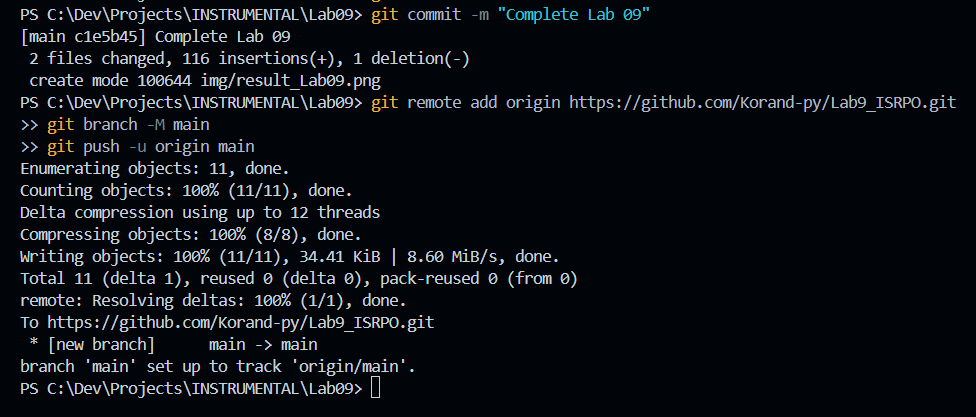
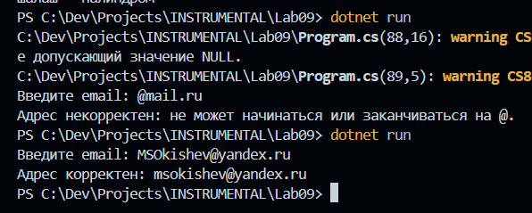

# Практическая работа №9 
**ФИО: Окишев Максим Сергеевич**   
**Группа: ИСП-242**   
**Дата: 04.11.2026** 
## Что изучено
- Работа со строкой как с набором символов
- Проверка содержимого строки (Contains, StartsWith, EndsWith)
- Преобразование строки (ToUpper, ToLower, Replace, Substring)

## Скриншоты

